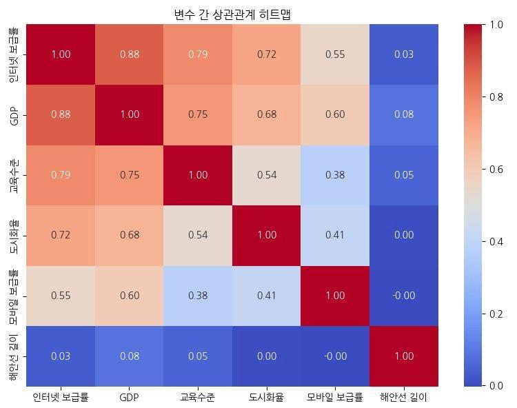
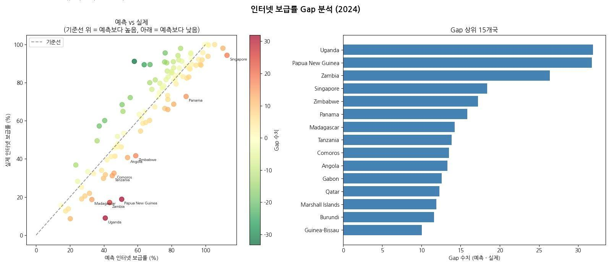
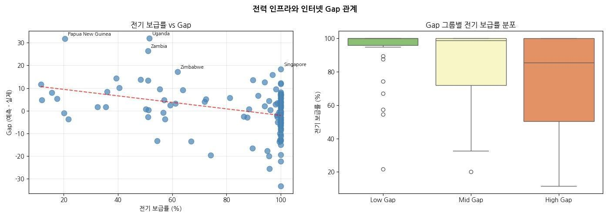
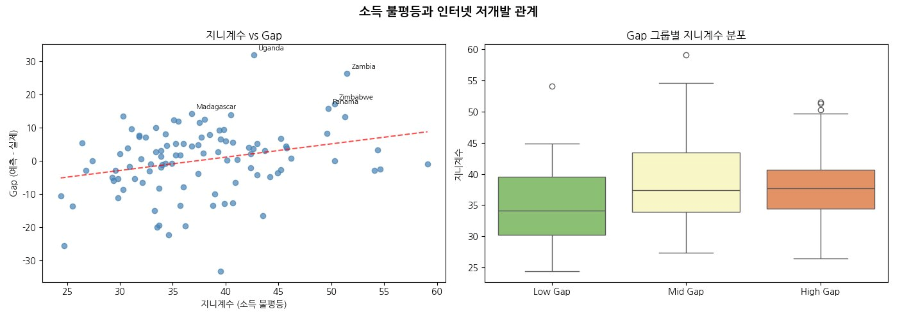
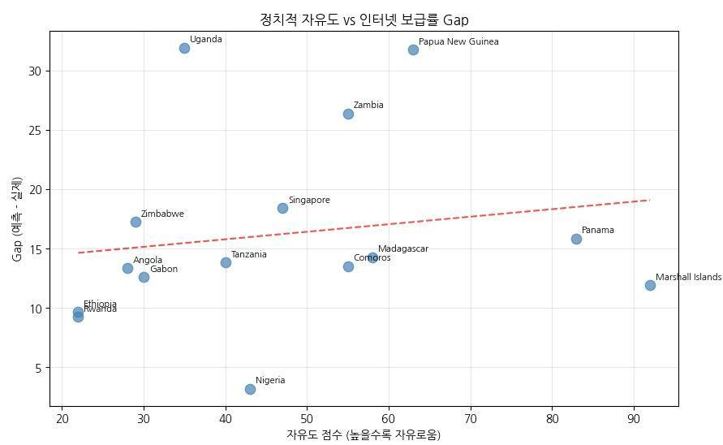
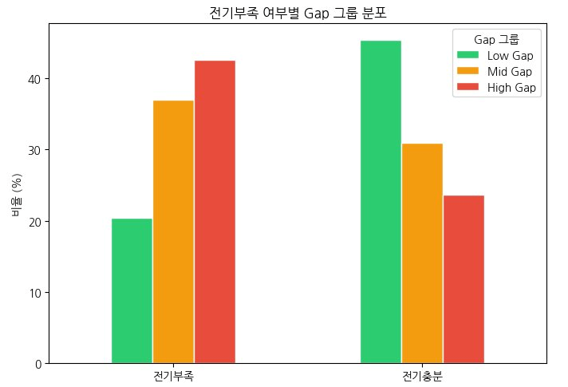
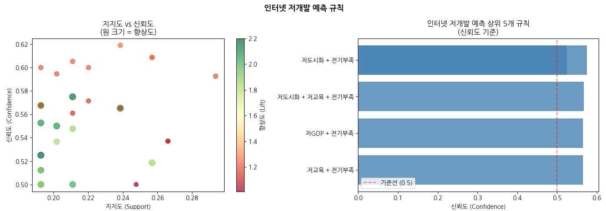

# 🌍 경제·사회적 조건 대비 인터넷 보급률 저개발 국가 식별 및 원인 분석

*Identifying Internet Penetration Underperformers and Analyzing Structural Barriers*

**잘사는 나라일수록 인터넷을 많이 쓴다. 그런데 조건에 비해 유독 인터넷 보급률이 낮은 나라는 어디고, 왜일까?**


> 2026.06 · 개인 연구 · 동양미래대학교 웹응용소프트웨어공학과

📄 [논문 (PDF)](docs/paper.pdf) · 📊 [발표자료 (PDF)](docs/slides.pdf) · 💻 [분석 코드 (Jupyter)](analysis.ipynb)

## 💡 한 줄 요약

GDP·교육·도시화·모바일 보급률로 "**이 나라라면 인터넷 보급률이 이 정도여야 한다**"를 예측하고, 실제 값과의 차이(**Gap**)로 저개발 국가를 찾았어요.
**우간다·파푸아뉴기니·잠비아**가 가장 크게 뒤처져 있었고, 가장 밀접한 원인은 소득 불평등이나 정치적 자유도가 아니라 **전력 인프라 부족**이었어요.

## 📦 데이터

| 출처 | 지표 |
|---|---|
| [World Bank API](https://data.worldbank.org/) (`wbgapi`) | 인터넷 이용자 비율, 1인당 GDP, 문해율, 도시화율, 모바일 보급률, 지니계수, 전기 보급률 (2010~2024) |
| CIA World Factbook 2025 | 국가별 해안선 길이 |
| Freedom House 2024 | 국가별 정치적 자유도 점수 (0~100) |

문해율과 지니계수의 결측치는 직전 연도 값으로 채웠고, 최종 분석 대상은 **2024년 기준 109개국**이에요.

## 🔬 분석 단계

1. **상관분석:** 히트맵으로 인터넷 보급률과 각 변수의 관계를 확인
2. **다중회귀 + Gap 분석:** `log(GDP)`, 문해율, 도시화율, 모바일 보급률로 예상 보급률을 예측(**R² = 0.835**)하고,
   `Gap = 예측 보급률 − 실제 보급률`이 큰 나라를 저개발 국가로 식별
3. **원인 분석:** 소득 불평등·정치적 자유도·전기 보급률과 Gap의 상관분석 → 교차분석 → 연관분석(Apriori)

## 📈 결과

### 1. 무엇이 인터넷 보급률과 관련 있나?
GDP **0.88** › 교육수준 **0.79** › 도시화율 **0.72** › 모바일 보급률 **0.55**. 해안선 길이는 **0.03**으로 거의 관계가 없었어요.



### 2. 조건에 비해 뒤처진 나라는?
**우간다(32.1) · 파푸아뉴기니(31.7) · 잠비아(26.4) · 싱가포르(18.4) · 짐바브웨(17.3)**



### 3. 왜 뒤처졌나?

| 요인 | 결과 |
|---|---|
| ❌ 소득 불평등 (지니계수) | Gap 그룹별 분포가 비슷함 → 주요 원인 아님 |
| ❌ 정치적 자유도 | r = 0.166, p = 0.555 → 유의미하지 않음 |
| ✅ **전기 보급률** | **r = −0.333, p < 0.001** → 전기가 부족할수록 Gap이 큼 |



- **교차분석:** 전기가 부족한 나라 중 High Gap 비율은 **42.9 %** 로, 전기가 충분한 나라(23.6%)의 약 **2배**예요.
- **연관분석:** 상위 5개 규칙(전기부족+저도시화, 전기부족+저교육 등) **모두에 "전기부족"이 들어 있었어요.** Confidence는 50~62%예요.

<details>
<summary>📊 다른 그래프 더 보기</summary>

**소득 불평등과 Gap**


**정치적 자유도와 Gap**


**전기 부족 × Gap 그룹 교차분석**


**연관분석 규칙**


</details>

## 🧭 시사점
- **정책:** 인터넷 격차를 줄이려면 경제·사회 발전뿐 아니라 **전력 인프라**도 함께 챙겨야 해요.
- **투자:** 우간다·파푸아뉴기니·잠비아는 전력이 좋아지면 인터넷 수요가 늘어날 가능성이 큰 시장이에요.
- **방법론:** 다중회귀 기반 Gap 분석으로 "조건 대비 뒤처진 나라"를 숫자로 찾는 방법을 제시했어요.

## ⚠️ 한계
- 도로망, 광케이블 매설 같은 다른 물리 인프라 지표는 넣지 못했어요.
- 2024년 한 해 데이터만 써서 인과관계는 확인하지 못했어요. 여러 해 데이터로 검증이 필요해요.
- 결측치 때문에 109개국만 분석했어요.
- 싱가포르처럼 이미 보급률이 포화된 고소득 국가는 모델이 너무 높게 예측해서 Gap이 크게 나올 수 있어요.

## ▶️ 코드 실행
[`analysis.ipynb`](analysis.ipynb)는 Google Colab 기준으로 작성했어요.

```bash
pip install wbgapi openpyxl statsmodels scikit-learn mlxtend
```

- World Bank 데이터는 코드에서 API로 바로 받아와요.
- 해안선 데이터는 `CIA_Factbook_2025_all_countries.xlsx` 파일이 필요해요(저장소에는 없어요).
- 노트북 안의 그래프는 저장할 때 한글 폰트가 깨져 있어요. 깔끔한 그래프는 위 이미지와 발표자료에서 볼 수 있어요.

## 📚 참고문헌
- Chinn, M. D., & Fairlie, R. W. (2007). The determinants of the global digital divide. *Oxford Economic Papers, 59*(1), 16–44.
- ITU. (2024). *Measuring digital development: Facts and figures 2024.* International Telecommunication Union.
